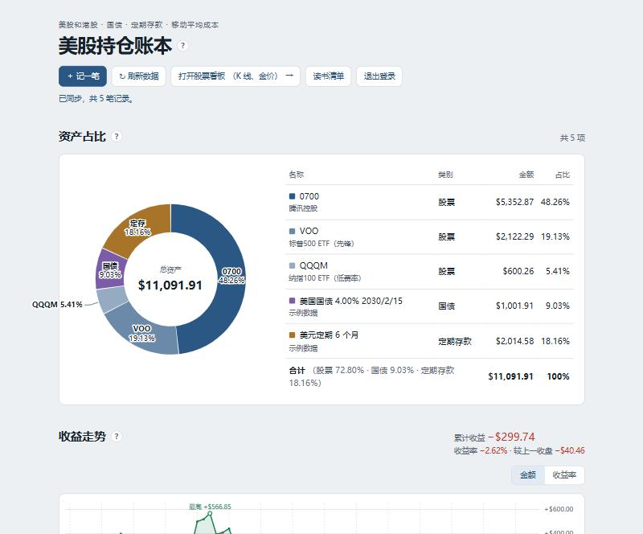
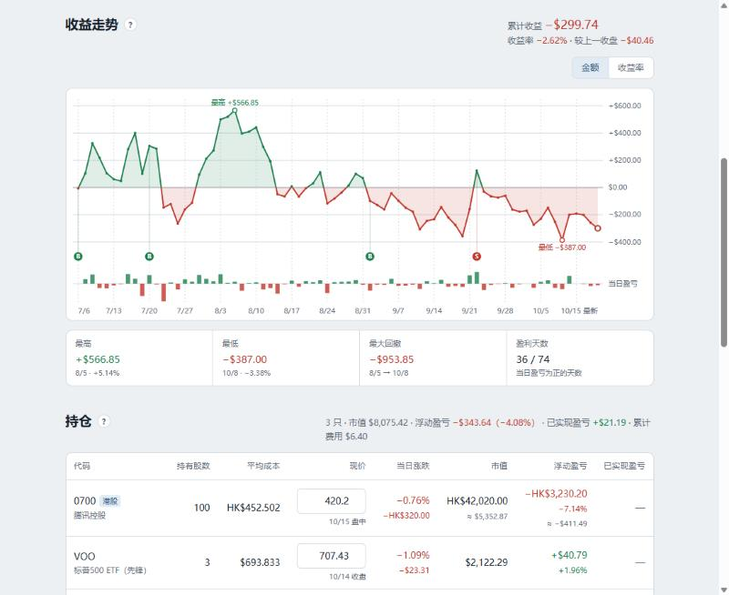
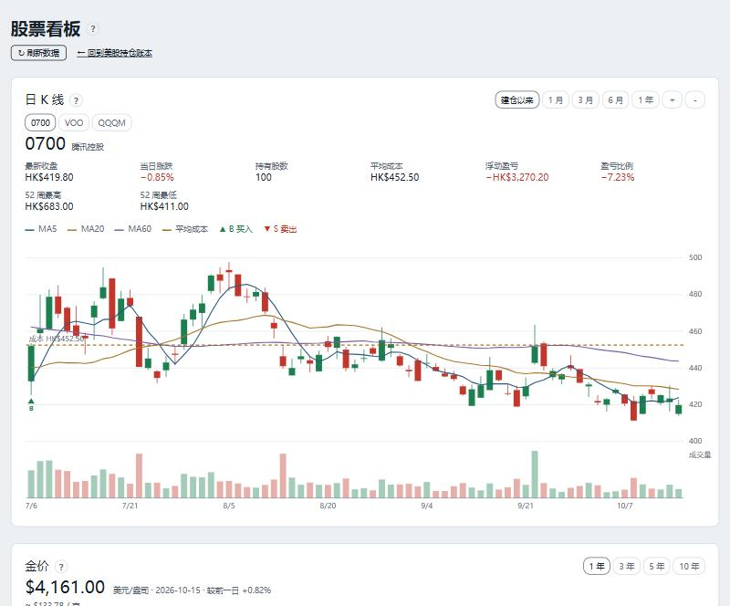

# 美股持仓账本

一个可以自己部署的个人投资账本：把**美股、港股、美国国债、定期存款**记在一处，自动算持仓成本、盈亏、资产占比和收益走势。

- 支持多人注册使用，每个账号的记录互相隔离；也可以关闭注册，只给自己用。
- 数据只存在你自己的服务器上（一个 SQLite 文件），不经过任何第三方服务。
- 只用 Python 标准库，不用装任何依赖，一台最便宜的云服务器就够。
- 中文界面，绿涨红跌，手机和电脑都能用。







（截图里是 `demo.json` 里的示例数据。）

## 功能

- **记一笔：** 股票买卖、美国国债、定期存款都在一个弹窗里录入；代码支持中文名、英文名搜索。
- **批量导入：** 上传券商 App 的成交截图，由 DeepSeek 或通义千问自动识别（需要开通，见下文），或者粘贴 Excel / CSV 表格，或者导入“账号”页导出的文件。识别结果先列成可修改的表格，标出可能重复的记录，确认后才保存。
- **持仓：** 移动平均成本、现价（可手动改）、当日涨跌、市值、浮动盈亏、已实现盈亏；港股按港元记，汇总时折成美元。
- **现金：** 记录账户里还没投资的钱（美元或港元），计入资产占比和总资产，不计入收益率。
- **国债和定期存款：**
  - 国债按持有到期计算：票息按天累计，买入价和面值的差额平摊到到期日，扣掉买入时付的应计利息；
  - 也可以填一个参考卖出价，改成按市价算；
  - 定存利息按天平摊。
- **资产占比：** 环形图加明细，按总资产（股票 + 国债 + 定存）算。
- **收益走势：** 每天的累计收益和收益率曲线，标出买卖点、最高、最低、最大回撤。
- **一年投资计划：** 从第一笔投资起算一年，显示进度、至今盈亏和资金加权收益率、年化收益率（满一年后固定为第一年的实际收益率）、日收益和日均收益，以及按月翻看的收益日历（每天一格，绿涨红跌）。
- **交易记录：** 按方向、代码筛选，按月分组小计。
- **股票看板：** 每只持仓的日 K 线（均线、成本线、买卖点），金价，美元兑人民币汇率。
- **投资读书清单：** 12 本入门书，可以打勾记进度、写笔记。
- **学习计划：** 金融数据开发方向的求职学习计划，分 6 个阶段，按日期标出当前阶段，可以打勾记进度。
- **刷新数据：** 点一下从腾讯财经、新浪财经取最新价格、收盘价和汇率。
- **账号：** 用户名加密码注册登录；可以修改密码、导出全部记录、注销账号（同时删除全部记录）；注册页附隐私说明。

## 本机试用

需要 Python 3.10 或更新版本。

```bash
git clone https://github.com/Wwz123Abc/stock-ledger.git
cd stock-ledger
python3 app.py serve
```

用浏览器打开 http://localhost:5090 ，点“注册”建一个账号，进去后点“刷新数据”取行情。

想看示例数据：注册后另开一个终端运行 `python3 app.py import 你的用户名 demo.json`，再刷新页面。

> Windows 上如果报 `ZoneInfoNotFoundError`，先运行 `pip install tzdata`。

## 部署到服务器（Ubuntu + nginx）

登录需要 **HTTPS**（登录凭证只在 HTTPS 下保存），所以需要一个域名。下面的命令都在服务器上执行。

```bash
# 0. 装好 git、nginx 和 certbot（Ubuntu 自带 Python 3）
sudo apt update && sudo apt install -y git nginx certbot python3-certbot-nginx

# 1. 建一个专用用户，把代码放到 /opt/stock-ledger
sudo useradd --system --home /opt/stock-ledger --shell /usr/sbin/nologin stockledger
sudo git clone https://github.com/Wwz123Abc/stock-ledger.git /opt/stock-ledger
sudo mkdir -p /opt/stock-ledger/data
sudo chown -R stockledger:stockledger /opt/stock-ledger/data

# 2. 开机自启的后台服务
sudo cp /opt/stock-ledger/deploy/stock-ledger.service /etc/systemd/system/
sudo systemctl daemon-reload
sudo systemctl enable --now stock-ledger

# 3. nginx 反向代理（先把 deploy/nginx.conf 里的 ledger.example.com 改成你的域名）
sudo cp /opt/stock-ledger/deploy/nginx.conf /etc/nginx/sites-available/stock-ledger
sudo ln -s /etc/nginx/sites-available/stock-ledger /etc/nginx/sites-enabled/
sudo nginx -t && sudo systemctl reload nginx

# 4. 免费 HTTPS 证书
sudo certbot --nginx -d 你的域名

# 5. 每天凌晨自动备份数据库（保留最近 30 份）
sudo cp /opt/stock-ledger/deploy/stock-ledger.cron /etc/cron.d/stock-ledger

# 6. 用浏览器打开 https://你的域名 ，注册你的账号
# 7. 只给自己用的话，注册完就关闭注册
sudo -u stockledger python3 /opt/stock-ledger/app.py registration off
```

**注意：** 在服务器上运行 `app.py` 的命令（导入、备份、重置密码等）时，要用 `sudo -u stockledger python3 app.py ...`，不要直接用 root 运行。否则新建的文件属于 root，后台服务没有权限读写。

在中国内地的服务器上用域名对外提供网站，需要先完成 ICP 备案。开放注册给别人用，意味着你在替他们保管财务记录，要对数据安全负责（《个人信息保护法》）；`static/privacy.html` 是一份隐私说明模板，请按你的实际情况修改，并补上你的联系方式。

### 开通截图识别（可选）

截图识别可以用 **DeepSeek**（`deepseek-flash` 模型）或**阿里云百炼**的通义千问（`qwen-vl-max`），都是按量付费，每张截图一般几分钱。

1. 在 DeepSeek 开放平台或阿里云百炼控制台创建一个 API Key（以 `sk-` 开头）。
2. 在服务器上运行 `sudo -u stockledger python3 /opt/stock-ledger/app.py vision-key`，粘贴 Key（只粘贴一次）。命令会自动判断是哪一家的 Key，并先确认 Key 有效再保存。不用重启。

每个账号每天最多识别 20 张，全站每天最多 300 张，识别失败的不计数，可以在 `app.py` 开头修改。截图会发送给所选的识别服务，隐私说明里已经写明。没有开通时，导入窗口里的截图识别按钮不可用，粘贴表格和导入文件照常可用。

### Docker（实验性）

```bash
docker compose up -d --build
docker compose exec ledger python app.py users
```

服务只监听本机的 5090 端口，前面同样需要 nginx 或 Caddy 提供 HTTPS。数据保存在名为 `ledger-data` 的 Docker 卷里。在中国内地，从 Docker Hub 拉取镜像可能很慢或失败，需要配置镜像加速。

## 日常维护

| 要做的事 | 命令（服务器上加 `sudo -u stockledger`） |
| --- | --- |
| 查看所有账号 | `python3 app.py users` |
| 有人忘记密码 | `python3 app.py reset-password 用户名`，把打印出的重置码（24 小时有效）告诉对方；对方在登录页点“忘记密码？”，输入用户名、重置码和新密码 |
| 删除账号 | `python3 app.py delete-user 用户名`（账号和全部记录一起删除） |
| 开通截图识别 | `python3 app.py vision-key`，按提示粘贴 DeepSeek 或阿里云百炼的 API Key（输入时不显示，只粘贴一次）；`vision-key off` 关闭 |
| 开放或关闭注册 | `python3 app.py registration on` 或 `off` |
| 手动备份 | `python3 app.py backup`（存到 `data/backups/`） |
| 命令行取行情 | `python3 app.py refresh 用户名` |
| 导入数据 | `python3 app.py import 用户名 文件.json`，格式见 `demo.json`，和“账号”页导出的文件相同 |
| 更新到新版本 | `cd /opt/stock-ledger && sudo git pull && sudo systemctl restart stock-ledger` |

全部数据就是 `data/ledger.db` 这一个文件，换服务器时把它复制过去就行。

**从单人版升级：** 旧版本只有一个密码、没有用户名。升级后第一次启动会自动把原来的全部记录移到账号 `admin` 下，用 `admin` 和原来的密码登录。

## 数据来源和免责声明

- **行情来源：** 股价和日 K 线来自腾讯财经，汇率、金价来自新浪财经，用的是它们网页上公开的接口。
  - 这些接口不是正式授权的数据服务，随时可能变化或失效，也可能有几分钟延迟；
  - 请只用于个人记账，并遵守数据提供方的使用条款。
- **隐私：** 点“刷新数据”时，服务器会把这个账号持有的股票代码发给上面两个网站查询价格。除此之外，记录不会离开你的服务器。行情、K 线、金价是所有账号共用的，但每个账号只能读到自己交易过的股票的数据，看不出别人持有什么。
- **不是投资建议：** 成本、收益、国债和定存收益都是按公式估算的，实际数字以券商或银行的单据为准。本项目不提供任何投资建议。

## 技术说明

- `app.py`：
  - 后端只有这一个文件：Python 标准库的 HTTP 服务器加 SQLite；
  - 负责账号（PBKDF2 密码哈希、HttpOnly Cookie、错误 5 次锁定 15 分钟、同一 IP 每小时最多注册 3 个）和数据的增删改查（`/api/c/<集合>`、`/api/d/<集合>/<id>`）；
  - 也负责取行情（`/api/refresh`，每个账号 30 秒内只能刷新一次）、批量导入（`/api/import`）和截图识别（`/api/recognize`）。
  - 每个账号最多 5000 条记录，全站最多 2000 个账号，可以在 `app.py` 开头修改。
- `static/`：前端页面，纯 HTML、CSS 和 JavaScript，不需要构建。
  - `index.html` 是账本首页；
  - `dashboard.html` 是股票看板，用到同目录的 D3；
  - `reading.html` 是读书清单，`plan.html` 是学习计划；
  - `login.html` 是登录和注册页，`account.html` 是账号页，`privacy.html` 是隐私说明。
- 数据按“集合”分开保存，每条记录是一个 JSON 文档：
  - 每个账号自己的：交易 `trades`、国债和定存 `fixed`、现金 `cash`、设置和现价 `config`、读书进度 `reading`、学习计划进度 `plan`；
  - 所有账号共用、只能由服务器写入的：收盘价 `history`、K 线 `candles`、金价和汇率 `watch`。

欢迎提 Issue 和 Pull Request。

## 许可

[MIT](LICENSE)。`static/d3.min.js` 是 [D3](https://d3js.org) v7.9.0，使用 ISC 许可，版权归 Mike Bostock 所有。
